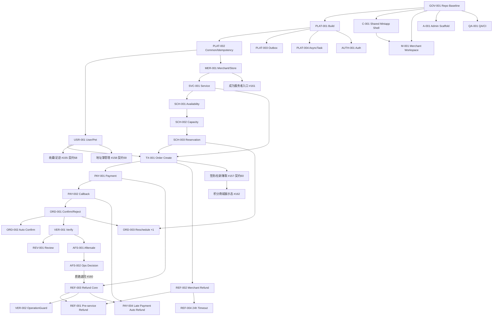

# Dependency Graph

前端 C/M/Admin 基于 Contract/Mock 可与后端并行，不要求等待所有后端节点完成。

REF-001 已按 2026-10-05 用户裁决随 PR #103 交付（分支 codex/ref001-auto-refund-20261002，默认关闭）：除原图 REF-003 外，实现另复用普通退款申请机制（契约49，ISSUE 目录 REF-002 切片：apply/决定/建单恢复/核销互斥），退款单来源为专门的服务前标记 PRESTART_AUTO（不复用 MERCHANT_TIMEOUT_AUTO）；因此上图补 REF2 → REFB 边。

## Wave2执行/完成附加门禁（不改原图的历史依赖）

- PLAT002公共ID/Clock固定片段 → PLAT004启动；不要求幂等整项DONE才可试验Worker，但禁止重复公共实现。
- CCR-W2-IDEMP → PLAT002幂等实现；CCR-W0-001 → PLAT003实现。
- CCR-ACR/PERM → AUTH真实实现/SDK；AUTH规范阶段自身可先起草。
- CCR-W2-API对应域 → USR/MER/SVC和业务页面契约；PLAT003 → MER真实下线事件。
- C002完整真实验收 → AUTH+USR；C003真实查询 → MER+SVC+SCH001/002；M002真实范围 → AUTH+MER+SVC+SCH及签约；A002真实治理 → ADM001+AUTH。

这些后置业务依赖不被强行拉入本波。批准Contract Mock可独立推进中间阶段，仍不等于完整Issue的E2E完成。C002与C003同Role/同目录串行，AUTH与USR的pet-user、PLAT003/004/AUTH的pet-boot按文件独占交接。

PLAT-004公共交接补充：接口与明确测试替身固定可开始开发，但完整生产Worker交付必须采用PLAT-002实际Snowflake提供器和Clock装配并验证；不以空接口判DoD，也无需等公共幂等整项DONE。

## 2026-10-10 目录重核注记

依赖结构自 2026-10-05 REF-001 注记后无实质变化：PR#126~#141 均为既有 Issue 范围内的切片交付（消费既有契约面或补齐既有 HTTP 面/页面），未新增 Issue 级依赖边，未撤销任何边。本次仅补画两处已交付但原图缺失的节点：

- `ORD-003 Reschedule ×1`：依赖 ORD-001（商家确认命令基础）与 SCH-003（预约生命周期/claim 交换），依 46号契约与 ISSUE_CATALOG 既有 Dependencies 列；HTTP 面与 C 端页面已由 PR#132 交付（内核 2026-09-29 批交付）。
- `REV-001 Review`：依赖 VER-001（核销事实决定评价资格），依 ISSUE_CATALOG 既有 Dependencies 列；已由 PR#134 交付（资格判定单真源在 ORDER 域，review-biz 依赖 order-api）。

节点交付状态（DONE/IN_PROGRESS/BLOCKED）不在本图维护，以 [ISSUE_CATALOG](ISSUE_CATALOG.csv) 为准（已重核至 2026-10-10）。QA-005 现状如实登记：核心交易闭环模拟器 E2E 一轮已全链通过（PR#133），运营Web主链 E2E 与二轮验收未做，故 IN_PROGRESS。

## 2026-10-14 目录重核注记

本批（PR#143~#163）新增两类结构变化：

1. **补画既有 Issue 间已交付的执行边**：`AFS-002 -->|原路退回 #160| REF-003`——32号裁决落定 OD-W0-001（V1 售后退款走微信支付原路退回，不做冻结/分账/提现/保证金，见 [32号裁决补充](../docs/01-prd/32-售后资金出路与未建页面裁决补充-v1.0.md)），PR#160 将 FULL/PARTIAL 终局决定接入既有 RefundAfterSaleCommandApi.create + AFTERSALE_REFUND_SUBMIT/CHANNEL_QUERY durable 任务族（WechatOriginalRouteRefundFundingAuthority，默认关闭 `pet.aftersale.refund.enabled`）。
2. **新增 32号裁决七页批能力节点**（FAV/ADDR/BEPROV/PTASK/MALL）：这些能力由 2026-10-13 用户裁决（PR#154）新增，**无既有 Issue 行**（原 66 行任务清单不含；本次重核未自造 IssueID，其状态与证据以重核 PR body 及 PR#155/#157/#158/#161/#162 为准）。锚点依据：收藏/足迹与地址簿落在 pet-user 域（58/59号契约）；成为服务者复用既有商家入驻申请链（merchantTypeCode 既有字典，零新契约）；签到/拉新赚取依赖订单首付事实（OrderQueryApi.firstPaidAt 只读加法，60号契约）；积分商城展示态复用积分读侧（只赚不花，无新后端面）。

既有依赖边结构无其他变化：视觉批次（#143/#148~#150/#152/#153）与测试修复（#146/#147/#159/#163）零功能面改动；#144/#145 为既有 REV-002/REF-002 范围内切片；#156 为 QA-005 范围内二轮验收（QA-005 仍 IN_PROGRESS：二轮模拟器矩阵 6 场景已过，售后平台裁决 UI、refund_order 禁核销反向分支、运营Web主链整链与物理真机未覆盖，详见 WORK_STATE 40.0）。节点交付状态仍以 [ISSUE_CATALOG](ISSUE_CATALOG.csv) 为准（已重核至 2026-10-14：DONE 47 / IN_PROGRESS 7 / BLOCKED 12）。

## 2026-10-16 目录重核注记

本批（PR#165~#174，HEAD 911230cf）**未新增 Issue 级依赖边、未撤销任何边、未新增能力节点**：61~64 号契约能力均落在既有 Issue 节点上，映射如下（节点交付状态以 [ISSUE_CATALOG](ISSUE_CATALOG.csv) 为准，已重核至 2026-10-16：DONE 58 / IN_PROGRESS 5 / BLOCKED 3）：

1. **61 号契约（券生命周期）→ CPN-001/CPN-002/QA-002/C-006**：PR#168 交付冻结-消费-释放-返券全链与 C 端选券入口；38/39/41 号既有订单链节点消费券域端口（可空装配，默认关闭）。CCR-CPN-LIFECYCLE-RULES-001 登记六项裁决缺口。
2. **62 号契约（百科内容）→ C-006 百科切片**：PR#165 交付 C 端读侧三路由与列表/详情两页（community 域 baike 子域；用户 2026-10-14 裁决做百科、不做社区——COM-001 冻结不受影响）。
3. **63 号契约（运营交易查询 v0.1→v0.2）→ ADM-002/A-003**：PR#166 七条只读查询+六页；PR#172 处置动作四条写路由（授权依据 [33 号裁决补充](../docs/01-prd/33-运营处置动作授权裁决补充-v1.0.md) 2026-10-15"可以开"，仅开 HTTP10 §5.2/§5.5/§5.6 既有草案；CCR-ADM-DISPOSAL-001 登记实现口径）。
4. **64 号契约（运营治理查询）→ ADM-001/A-002**：PR#171 八条只读治理路由+商家台账/排期查看/员工治理三块页；写侧治理动作（冻结/解冻等）无授权仍开放，开放需 CCR。
5. **收口边（既有节点完成既有验收义务，无新边）**：SCH-004 ← #167 专项验收（Sch004JointAcceptanceMySqlTest，53 号联链）；REF-004 ← #173 核实收口（RefundMerchantTimeoutAcceptanceMySqlTest + [docs/07-testing/17 号](../docs/07-testing/17-REF004-商家退款超时自动批准核实-v1.0.md)）；QA-002 ← #168 券并发+容量补缺；QA-003 ← #173 支付超时×回调并发矩阵。
6. **PTS 订单奖励节点**：PR#170 将 PTASK（签到/拉新赚取 #157·契约60）的 FIRST_ORDER 奖励升级为订单绑单发放，并新增退款按比例扣回消费边 `RefundSucceededEvent.v1 → POINTS_REFUND_CLAWBACK`（60 号 §7，PTS-001/PTS-002，装配默认关闭）；PR#174 以 order 域 O(1) 首付事实端口（OrderFirstPaidFactsApi，07 号 §7.1.1）收口 CCR-POINTS-ORDER-001，替代 listMyOrders 分页扫描。

用户裁决结构注记（2026-10-14）：社区不做（COM-001 保持 BLOCKED 冻结）、第三方团购核销暂不做（THD-001 保持 BLOCKED）；两者均无新节点、无新边。PRD 对齐（用户 2026-10-15 裁决）：C 端 PRD §5.1.21 售后退款不返券条款按 SSOT §9.1 对齐（[34 号裁决补充](../docs/01-prd/34-售后退款优惠券返还SSOT对齐裁决补充-v1.0.md)），不影响依赖图结构。QA-004 的 PR #175 在途未合，不记为已交付。
